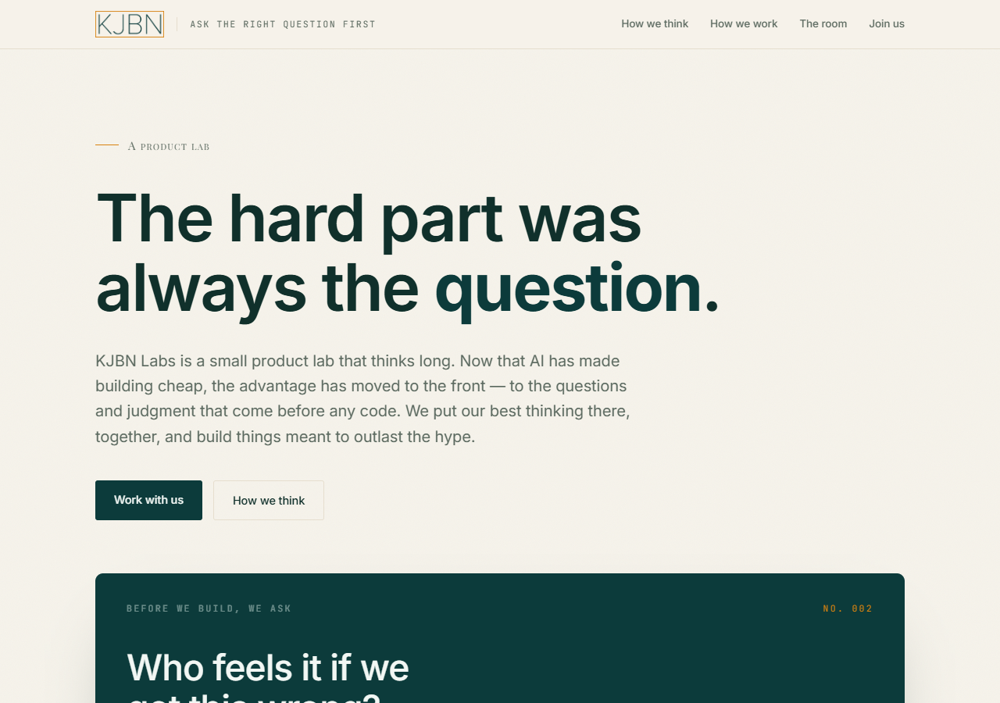
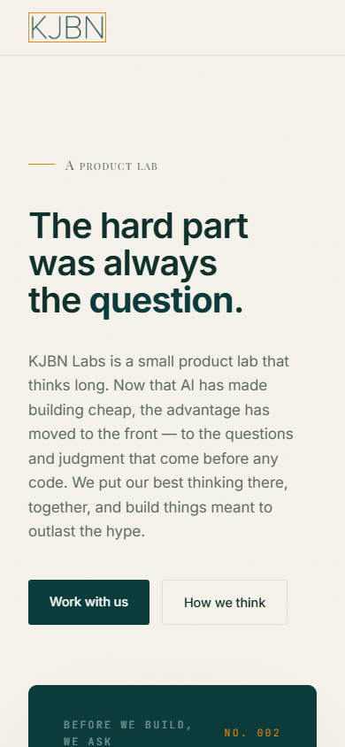
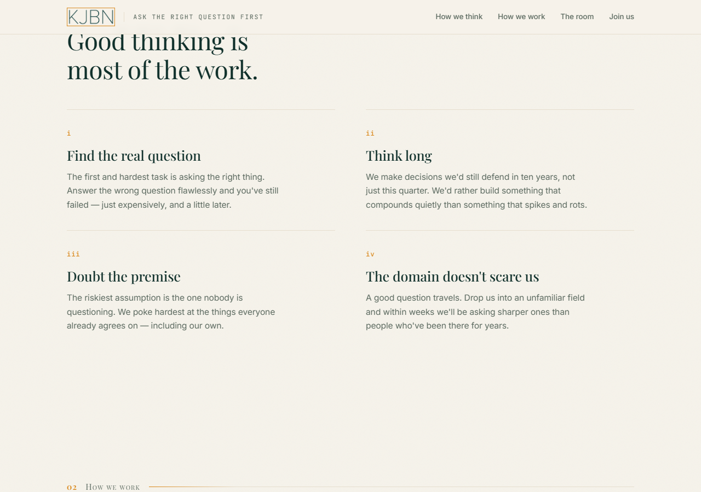
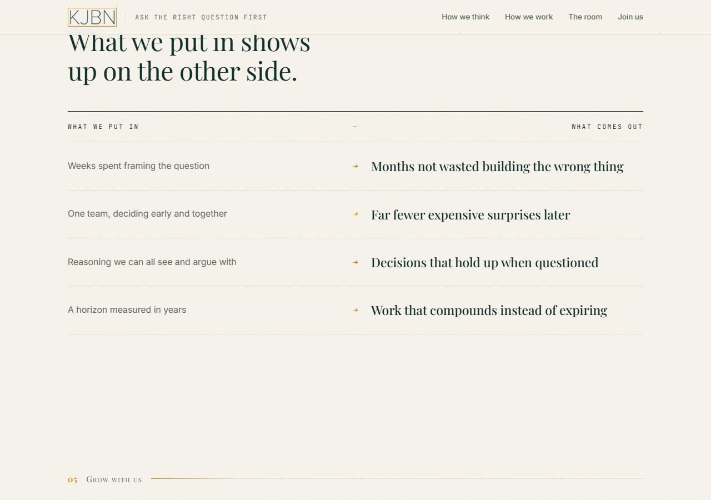
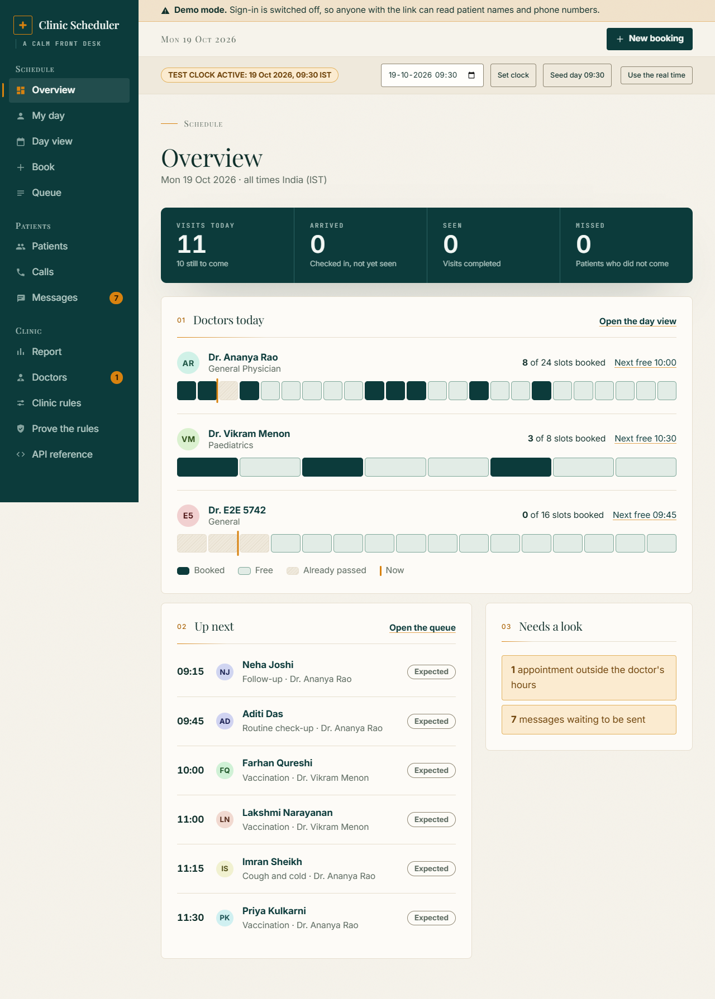
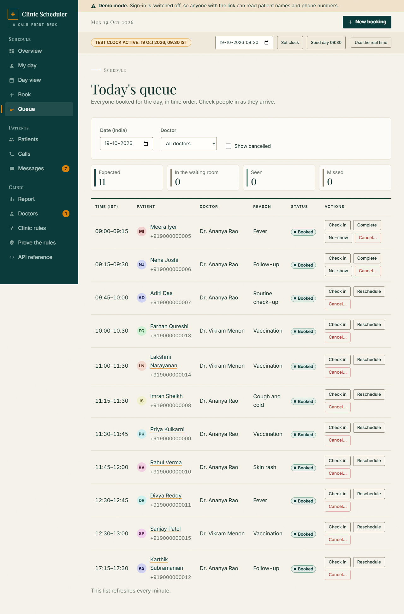
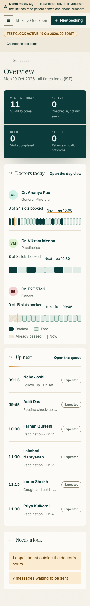
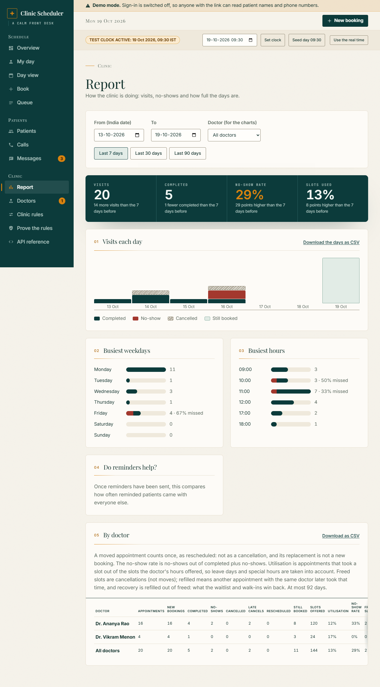

# The KJBN Labs design language, as a clinic

The interface follows the look of KJBN Labs' own website, adapted so it reads as a clinic's front
desk. This page is the evidence: what the site does, taken from the live page, and where each part
shows up in the app.

- **Source:** https://kjbnlabs.in/ (`kjbnlabs.com` redirects to it), "KJBN Labs — A product lab".
- **Captured:** 19 October 2026, in desktop Chrome at 1280 px and a 390 px phone.
- **How the values were read:** the page's stylesheet is inline in its HTML, so the colours, fonts and
  sizes below are copied from its own CSS and confirmed with computed styles in the browser. Nothing
  is guessed from a screenshot.

## What the site looks like

| | Desktop | Phone |
|---|---|---|
| The top of the page |  |  |
| A grid of principles with hairline rules |  | |
| The "trade" table |  | |

## The values, copied from the site's CSS

| Token on kjbnlabs.in | Value | Measured in the browser |
|---|---|---|
| `--paper` (page) | `#F6F3EB` with a faint SVG noise grain at 4% | body background `rgb(246, 243, 235)` |
| `--paper-2` | `#EFE9DC` | |
| `--ink` (text) | `#10302B` | body colour `rgb(16, 48, 43)` |
| `--muted` | `#5C6A60` | |
| `--petrol` (primary, the signature block) | `#0C3B3B`, with `--petrol-line` `#2C6363` | primary button and signature block `rgb(12, 59, 59)` |
| `--saffron` (the one accent) | `#D8820F`, soft `rgba(216,130,15,.14)` | |
| `--line` | `#E6DECE` | |
| Body type | Inter, 17 px, line-height 1.6, letter-spacing -0.006em | `17px`, weight 400 |
| Hero title | Inter 600, up to 84 px, "em" in petrol | `84px`, weight 600 |
| Section titles | Playfair Display 400, up to 46 px, italic petrol "em" | `46px`, weight 400 |
| Eyebrows and section labels | Playfair Display small-caps, tracked 0.085em, 15 px, with a 30 px saffron rule | `15px`, `rgb(92, 106, 96)` |
| Tagline and small labels | JetBrains Mono, 11.5 px, uppercase, tracked 0.14 to 0.2em | |
| Buttons | 14.5 px, weight 500, radius **3 px**, petrol fill or 1 px hairline, lift 1 px on hover | radius `3px` |
| Signature block | petrol, radius 10 px, soft deep shadow, mono labels, saffron figures | radius `10px` |
| Top bar | sticky, 62 px, paper at 80% with a blur, a hairline underneath | |
| Motion | one rise-into-place on load, 0.85 s, `cubic-bezier(.22,.61,.36,1)`; off under reduced motion | |
| Focus | 2 px saffron outline, 3 px offset | |

## Where each part shows up in the clinic app

| KJBN Labs | In the clinic app |
|---|---|
| Warm paper with a faint grain, ink-green text | The page, cards and text colours are these values (`styles.css` tokens). |
| The petrol signature block with mono labels and a saffron number | The day's figures on the Overview, My day and Report are one petrol block: tracked mono labels, large Inter figures, a saffron highlight when someone did not come. |
| A thin saffron-outlined logo box and a mono tagline beside a hairline | The brand mark is a saffron-outlined cross beside the name in Playfair Display, with the date set off by a hairline. |
| A sticky top bar with the pages as text links | One sticky masthead: the brand and the main action above, the pages as grouped text tabs (Schedule, Patients, Clinic) below, a saffron underline on the current page. On a phone the tabs become a petrol menu with serif small-caps group labels. |
| A serif small-caps eyebrow with a saffron rule above each title | Every page opens with its group name the same way ("Schedule", "Patients", "Clinic"). |
| Playfair Display titles over Inter | Page and card titles are Playfair Display; every working surface (forms, tables, buttons) is Inter. |
| Numbered sections "05 Grow with us" and a rule that fades from saffron | Cards on the Overview and the Report are numbered 01, 02, 03 in saffron over a rule that fades to a hairline. |
| The "trade" table: ink rule on top, tracked caps headers, hairline rows, no boxes | The queue, the calls list, messages, staff and the report use that table. |
| Square-ish 3 px buttons, filled petrol or hairline | Buttons are 4 px: petrol for the one main action, a hairline for the rest, a lift on hover. |
| One orchestrated entrance | A page rises into place once; nothing else moves on its own. |
| Saffron as the only accent | Saffron marks "now" (the day view line and the ribbon), the current page and the counts that need attention. |

## Where the app deliberately differs

- **A working tool, not a landing page.** The reference is a page to read; this is used all day. Tables
  are denser, body text is 16 to 17 px, and there is no 84 px headline.
- **Visible control borders.** A hairline `#E6DECE` is too faint to find a field by, so inputs and
  secondary buttons use `#8E8672`, which keeps a 3:1 edge against the paper.
- **A darker focus colour.** Saffron `#D8820F` has under 3:1 against the paper, so the focus ring is
  `#B86E08`; on the petrol panel it is a light amber.
- **Small label contrast.** The muted petrol-panel text is raised to 76% opacity so every small label
  passes 4.5:1; the accessibility scan covers every page.
- **Clinic content.** Status words come first and colour second, times are shown in India time, and
  the "now" line, the day ribbon and the slot book are clinic ideas, not from the reference.

## Side by side

| KJBN Labs | The clinic app |
|---|---|
|  |  |
|  |  |
|  |  |

The report page, for the tracked-label figures and the numbered sections:

## Fonts

Inter, Playfair Display and JetBrains Mono are the reference's own fonts. They are bundled with the
app (npm `@fontsource-variable/*`), not loaded from Google, so the content security policy
(`font-src 'self'`) and the no-third-party rule still hold. The build never inlines a font as a
`data:` URL, which that policy would block.
